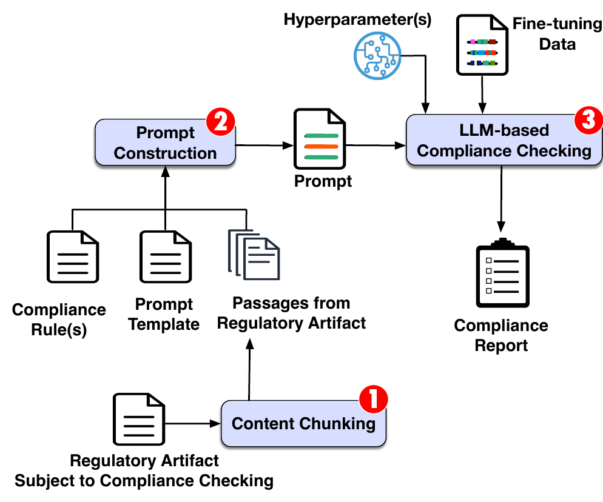

# Compliance
Rethinking Legal Compliance Automation:
Opportunities with Large Language Models

2024 IEEE 32nd International Requirements Engineering Conference (RE), pages 432-440. [Paper (DOI)](https://doi.org/10.1109/re59067.2024.00051) · [arXiv](https://arxiv.org/abs/2404.14356)

## Overview



Fig. 1 from the paper: approach overview.

As software-intensive systems face growing pressure to comply with laws and regulations, providing automated support for compliance analysis has become paramount. Despite advances in the RE community on legal compliance analysis, important obstacles remain in developing accurate and generalizable compliance automation solutions. This paper highlights some observed limitations of current approaches and examines how adopting new automation strategies that leverage Large Language Models (LLMs) can help address these shortcomings and open up fresh opportunities. Specifically, we argue that the examination of (textual) legal artifacts should, first, employ a broader context than sentences, which have widely been used as the units of analysis in past research. Second, the mode of analysis with legal artifacts needs to shift from classification and information extraction to more end-to-end strategies that are not only accurate but also capable of providing explanation and justification. We present a compliance analysis approach designed to address these limitations. We further outline our evaluation plan for the approach and provide preliminary evaluation results based on data processing agreements that must comply with GDPR. Our initial findings suggest that our approach yields substantial accuracy improvements and, at the same time, provides justification for compliance decisions.

 ```bash
.
├── Code
├── Data
└── Evaluation Result

```

### Execution Instructions
* Create a python environment with the packages listed in: Code/requirements.txt 
* Open the environment and proceed to Code

* Execute the code Call_LLM.ipynb for GPT experiments
* Execute the code Zephyr.py, Mixtral.py, or Mistral.py for open-source model experiments

* For GPT experiments, set your OpenAI key in the Call_LLM.ipynb

* Execute the code Call_LLM.ipynb 

## Citation

```bibtex
@inproceedings{Hassani_2024,
  title     = {Rethinking Legal Compliance Automation: Opportunities with Large Language Models},
  author    = {Hassani, Shabnam and Sabetzadeh, Mehrdad and Amyot, Daniel and Liao, Jain},
  booktitle = {2024 IEEE 32nd International Requirements Engineering Conference (RE)},
  pages     = {432--440},
  year      = {2024},
  month     = {June},
  publisher = {IEEE},
  doi       = {10.1109/re59067.2024.00051}
}
```
